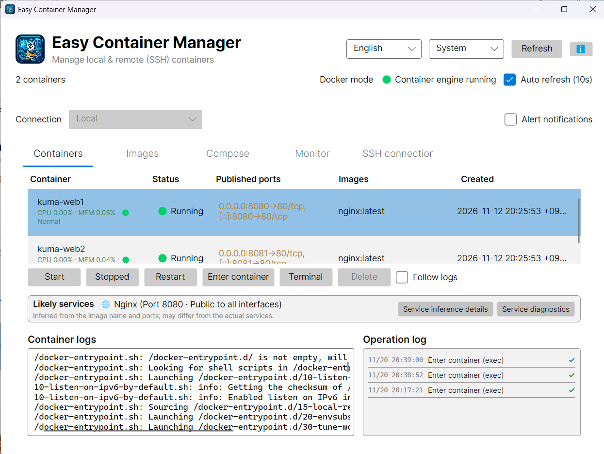
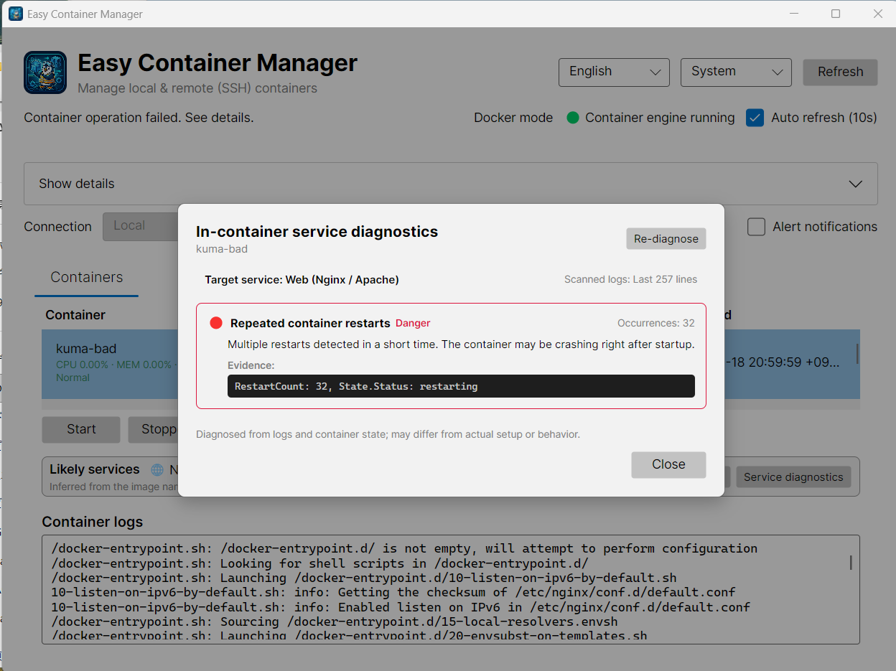
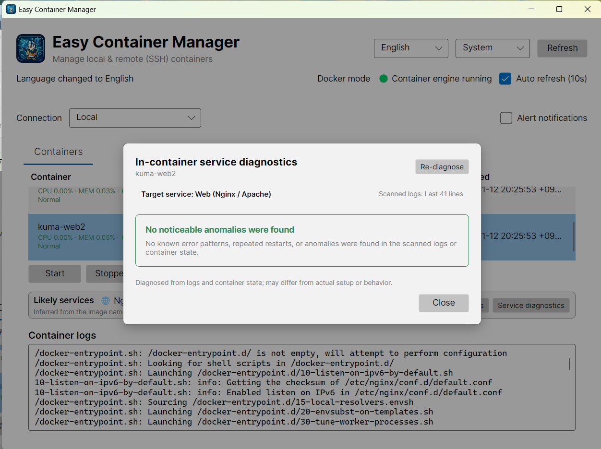
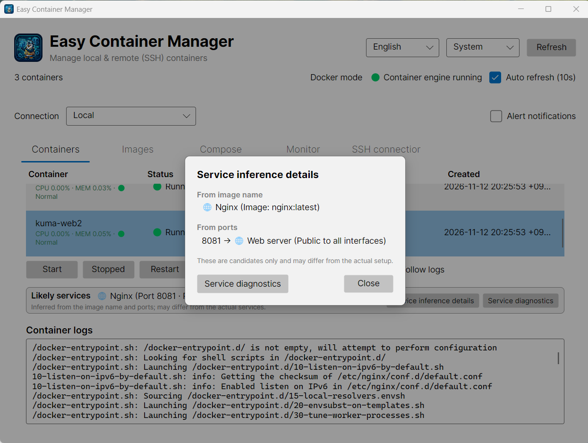
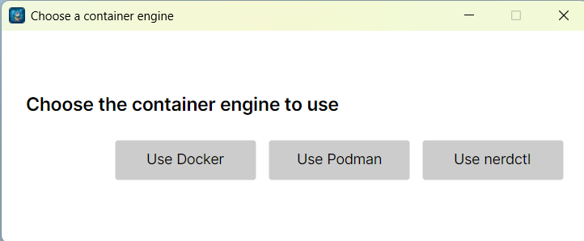
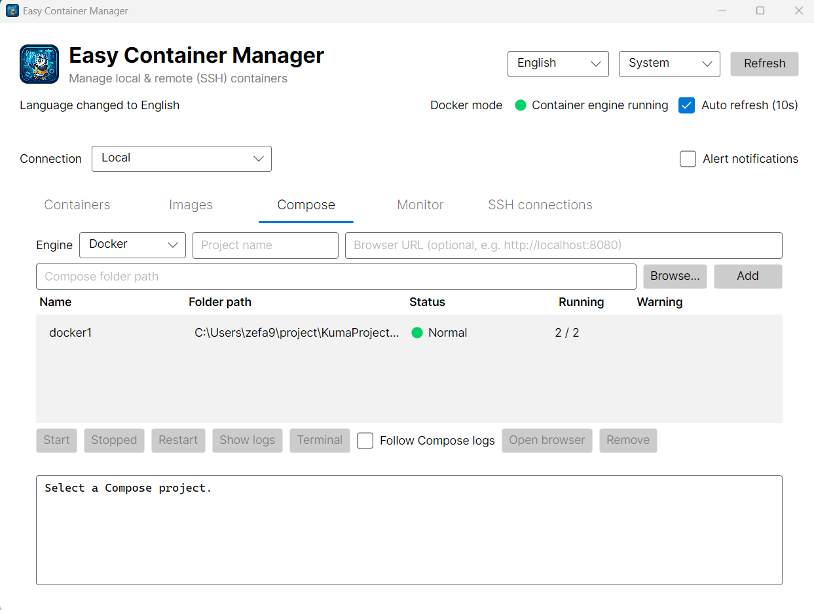
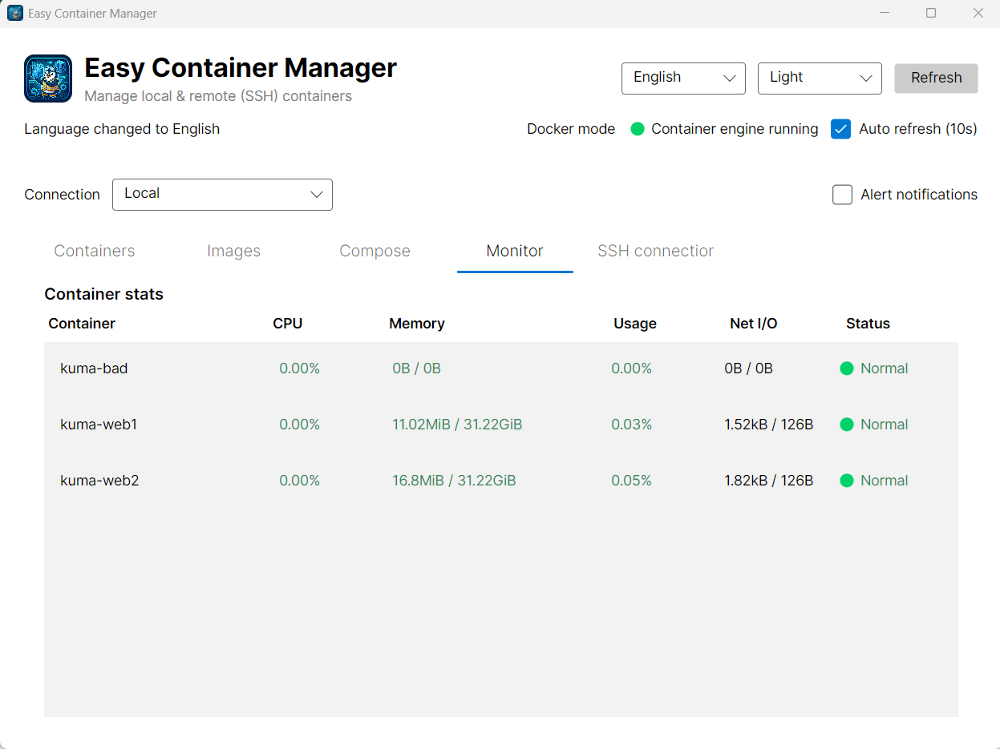
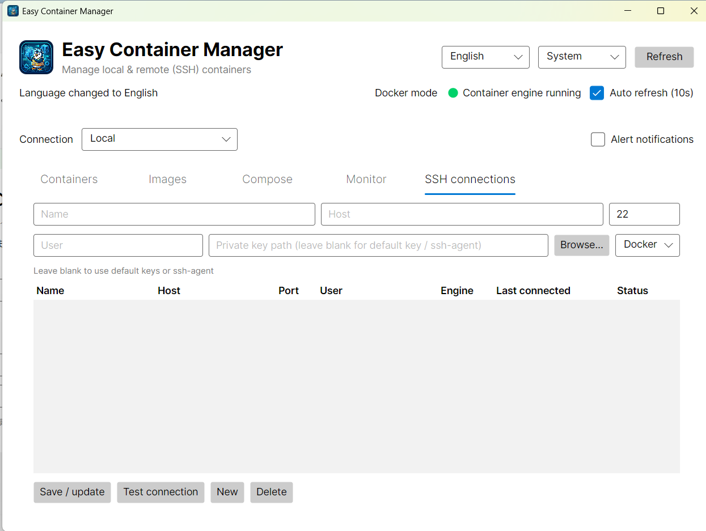
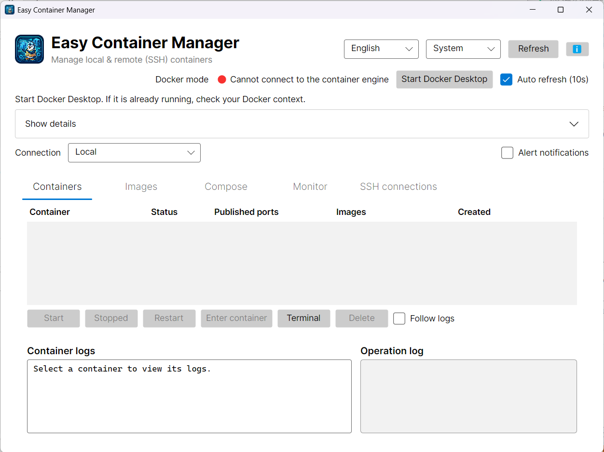
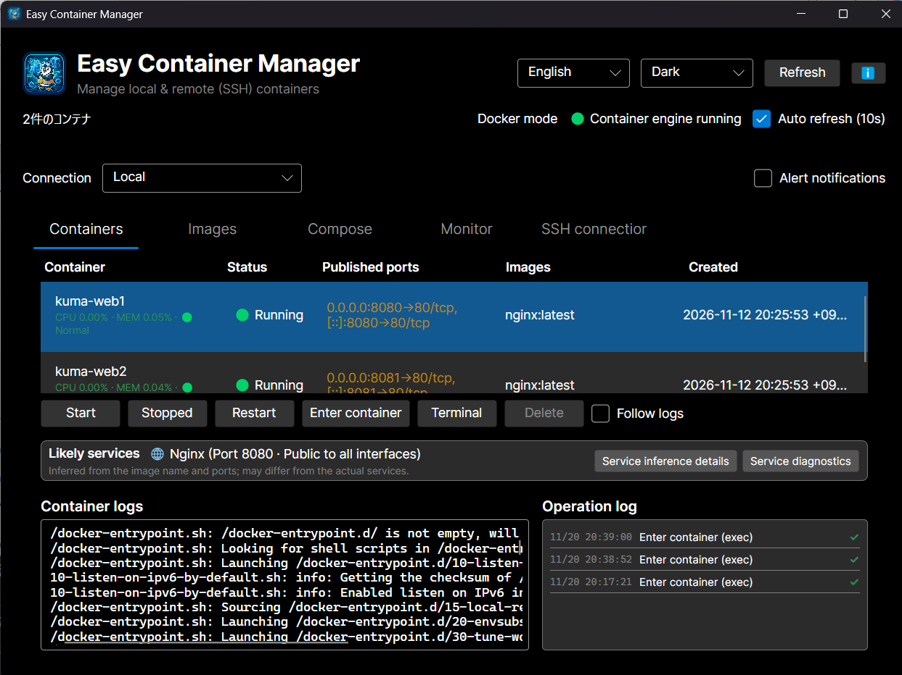

# EasyContainerManager

[](https://github.com/kumatarosasaki3891-art/EasyContainerManager/releases)
[](#-download)
[](LICENSE)

English | [日本語](README.md)

An Avalonia (F# / .NET 10) desktop application for managing local and remote (SSH) Docker, Podman, and nerdctl containers, images, and Compose projects from a single interface.  
It also provides real-time resource monitoring, port exposure highlighting, and local read-only in-container service & version diagnostics.

> A lightweight cross-platform desktop manager for Docker, Podman, and nerdctl containers, images, and Compose projects—supporting local & SSH remote hosts, resource monitoring, and local read-only diagnostics.

---

## 📥 Download

- **🐧 Linux (Flatpak bundle)**: [GitHub Releases](https://github.com/kumatarosasaki3891-art/EasyContainerManager/releases) (or build locally using the Flatpak instructions below and [FLATHUB_GUIDE.md](FLATHUB_GUIDE.md))
- **🪟 Windows 10 / 11**: [Project Website](https://sites.google.com/view/kuma-applications/) / Microsoft Store (coming soon; you can also build from source and package as MSIX using the instructions below)

---

## 📸 Screenshots



**Main screen — container list** — Manage containers in one list — port exposure is color-coded

| Service diagnostics (findings) | Service diagnostics (no findings) |
| :---: | :---: |
| <br>Log-based diagnostics, with the evidence lines for each finding | <br>When nothing is found, the result says so clearly |

| Service inference details | Engine selection |
| :---: | :---: |
| <br>See the basis of each inference, split by image and ports | <br>Docker, Podman and nerdctl — choose your engine at startup |

| Compose | Monitor |
| :---: | :---: |
| <br>Start, stop and inspect Compose projects | <br>Monitor CPU, memory and network with 10-second auto-refresh |

| SSH targets | Engine not running |
| :---: | :---: |
| <br>Manage SSH targets — key paths only, no passwords stored | <br>Guidance and a launch button when the engine is not running |

| Dark mode |  |
| :---: | :---: |
| <br>Light and dark themes |  |

---

## Key Features

- **Multi-Engine Auto-Detection (`Docker` / `Podman` / `nerdctl`)**
  - Detects `docker`, `podman`, and `nerdctl` CLIs at startup. Automatically launches into the detected engine when only one is installed, or displays a selection window when multiple engines or none are found.
- **Published Port Exposure Highlighting**
  - Displays published ports parsed from `inspect` (such as `0.0.0.0:8080->80/tcp` or `127.0.0.1:8080->80/tcp`) and highlights bindings exposed on all interfaces (`0.0.0.0` / `[::]`) in warning colors.
- **Service Inference & In-Container Service Diagnostics (`ServiceInference.fs` / `ServiceDiagnostics.fs`)**
  - Infers likely running services from image names and published ports, with one-click access to "Service inference details" and "In-container service diagnostics".
  - Runs strictly read-only, local analysis over `inspect` state and recent container logs—detecting repeated restarts, `OOMKilled`, and error patterns (Nginx / Apache / MySQL / MariaDB / PostgreSQL / Redis / generic errors) with evidence log excerpts.
- **Version Diagnostics & Local SQLite Cache (`VersionDiagnostics.fs` / `MasterDataRepository.fs`)**
  - Uses public definition data ([`kuma-master-data`](https://github.com/kumatarosasaki3891-art/kuma-master-data)) cached in a local SQLite database to check container engines (`docker`, `podman`, `nerdctl`) and container runtimes (`nginx`, `php`, `mysql`, `mariadb`, `postgres`, `redis`, `httpd`, `node`, `python`) for End-of-Life (EOL) branches, version lag, and curated critical advisories.
  - All diagnostics execute locally on your device; no user data or diagnostic results are ever sent externally.
- **Per-Target Operation History (`OperationLog.fs`)**
  - Records user-initiated container actions (start, stop, restart, remove, exec) and Compose actions (up, down, restart) with timestamp, status (`✓`/`✗`), and brief error details in local SQLite (`operation_log`, up to 20 newest entries per container or Compose project), displayed alongside logs and in the diagnostics dialog (background auto-refresh polling is excluded).
- **Resource Monitoring & In-App Alerts**
  - Tracks per-container CPU, memory, and network I/O along with Compose stack health, showing in-app notifications when thresholds or failures occur.
- **Secure SSH Remote Management (`StrictHostKeyChecking=yes`)**
  - Manages remote Docker, Podman, and nerdctl hosts using your local OpenSSH `ssh` client. Passwords and private key contents are never stored, and connections run with `BatchMode=yes`.
- **Container Shell & Host Terminal Integration**
  - One-click launch into a container shell (checking `bash` first, then falling back to `sh`), host terminal, or Compose project directory terminal.
- **11 Languages & Theme Support (`Localization.fs`)**
  - Supports 11 languages (English, Japanese, Simplified Chinese, Traditional Chinese, Korean, French, German, Spanish, Italian, Portuguese, and Russian) and Light / Dark / System themes.

---

## Usage & Feature Details

### General Behavior & Auto Refresh

- **Auto Refresh**: Updates the details pane cleanly after each refresh cycle finishes, avoiding redundant redraw notifications if content has not changed. Error details and their open/collapsed state are preserved while an error persists and cleared upon recovery.
- **Operation Safety**: Container, image, and Compose action buttons remain usable during auto-refresh (actions execute once the refresh completes, and are skipped if the target item no longer exists). Switching connections or editing SSH settings waits until the active refresh finishes.
- **Compose Logs**: Selecting a project in the Compose tab automatically loads the last 50 log lines; clicking "Show logs" fetches the full log output.

### Monitoring (`Monitor` Tab)

- **CPU**: Below 50% is Normal, 50% or higher is Caution, 80% or higher is High. Multi-core values exceeding 100% are supported.
- **Memory**: Below 70% is Normal, 70% or higher is Caution, 90% or higher is High. Displays usage, limit, and percentage.
- **Compose**: Uses `docker compose`, `podman compose`, or `nerdctl compose` to show running/total existing containers and lists stopped or `unhealthy` service names in the warning bar (uncreated services are excluded from total counts; note that `nerdctl` compose output does not expose health status).
- **Path Tooltip**: Hovering over a Compose project's folder path shows the full path in a tooltip.
- **Alert Notifications**: When "Alert notifications" is enabled, high CPU, high memory, and Compose warnings trigger in-app notifications. Ongoing issues do not repeatedly alert until they recover and recur. No OS notification center alerts or background monitoring after closing the app are performed.

### Version Diagnostics & Master Data

- In the "Service diagnostics" dialog, in addition to log and state checks, engine and in-container runtime versions are evaluated against the `kuma-master-data` definitions.
- Matching always runs locally against the built-in SQLite cache, allowing offline operation using the bundled initial snapshot or previously cached data.
- Network requests occur only to fetch read-only public JSON files (`penguin/engines.json`, `penguin/runtimes.json`, `apps.json`) from GitHub at startup (at most once per day) or when clicking "Update definitions" in the About (`ℹ️`) dialog. No user data or diagnostic results are transmitted.

### SSH Connections

Requires the local OpenSSH `ssh` CLI and the selected container engine CLI installed on the remote Linux host (plus a Compose provider on the remote host when using Podman mode).

1. On the **SSH connections** tab, enter a connection name, host, port, user, and private key path (leave blank to use default keys or `ssh-agent`), and select the remote engine (`Docker`, `Podman`, or `nerdctl`). Passwords and private key contents are never stored.
2. Connect once manually from your terminal beforehand to verify the host key fingerprint and register it in `known_hosts`.
3. For encrypted keys, load them into `ssh-agent` and leave the private key path blank (on Windows, ensure the OpenSSH `ssh-agent` service is running). The app never prompts for passwords or passphrases.
4. Verify with "Test connection", click "Save / update", and select the host from the top "Connection" selector.

- Runs with `BatchMode=yes` and `StrictHostKeyChecking=yes` (never bypasses or auto-accepts host keys). The remote user must be able to invoke the chosen container CLI without a `sudo` prompt.
- "Test connection" runs `echo OK` over SSH; container engine availability is checked when selecting the connection. Last connected timestamps are saved, while live status indicators apply only during the current session.
- Compose project registrations are stored per connection (use absolute remote paths when connected via SSH; the private key browse button selects local files).
- In local mode, the Compose tab provides an engine dropdown to switch between Docker, Podman, and nerdctl (each engine stores its own registered folders; locked to the connection's engine during SSH sessions). Switching engines or connections clears the selection, log view, input fields, and stops log following. Switch back to Local before editing or deleting an active SSH connection.
- Registered browser URLs open in your local default browser (no SSH port forwarding is performed).

### Terminal & Engine-Specific Notes

- **Terminal Integration**: "Enter container" checks whether `bash` is available in the selected container and falls back to `sh` if unavailable. Host "Terminal" and Compose folder "Terminal" open Windows Terminal (or PowerShell fallback) on Windows, GNOME Terminal or Konsole on Linux, or an interactive OpenSSH session for remote connections.
- **nerdctl Mode**: Uses `nerdctl` on `PATH`. Ensure `containerd`, CNI plugins, and BuildKit are configured beforehand; the app does not auto-start `containerd` or connect into WSL automatically.
- **Podman Mode**: Compose operations require `podman-compose` or `docker-compose`. When using `docker-compose` on Windows, Podman machine API forwarding (`win-sshproxy` and named pipe) must be active. Restarting the Podman machine affects running containers, so save your work first.

---

## Getting Started & Building from Source

### 1. Run and Verify from Source (.NET 10 SDK)

```powershell
# Launch the application
dotnet run --project EasyContainerManager/EasyContainerManager.fsproj

# Run verification scripts (no Docker or SSH server required)
dotnet fsi tests/VerifyV04.fsx
dotnet fsi tests/VerifyServiceInference.fsx
dotnet fsi tests/VerifyServiceDiagnostics.fsx
dotnet fsi tests/VerifyVersionDiagnostics.fsx
dotnet fsi tests/VerifyOperationLog.fsx
```

### 2. Build MSIX Package (Windows / Microsoft Store)

> **Note:** For public release on GitHub, Microsoft Store identifiers and publisher details in [`EasyContainerManager/Packaging/msix/AppxManifest.xml`](EasyContainerManager/Packaging/msix/AppxManifest.xml) and [`EasyContainerManager/EasyContainerManager.fsproj`](EasyContainerManager/EasyContainerManager.fsproj) have been masked with `XXX`. Replace them with your own values before packaging for your environment.

With Windows 10/11 SDK (`makeappx.exe` / `signtool.exe`) installed:

```powershell
# Create an unsigned MSIX (win-x64) for Microsoft Store submission
powershell -ExecutionPolicy Bypass -File EasyContainerManager/build-msix.ps1

# Create a combined x64 / arm64 .msixbundle
powershell -ExecutionPolicy Bypass -File EasyContainerManager/build-msix.ps1 -Architectures x64,arm64 -Bundle

# Sign with a self-signed test certificate for local sideloading
powershell -ExecutionPolicy Bypass -File EasyContainerManager/build-msix.ps1 -SignTestCert

# Or build via MSBuild target
dotnet msbuild EasyContainerManager/EasyContainerManager.fsproj -t:BuildMsix -p:Configuration=Release
```

Output packages are placed under `EasyContainerManager/bin/msix/`.

### 3. Build Flatpak Package (Linux)

Packaging files for `org.freedesktop.Platform//25.08` and the `.NET 10 SDK` extension are included. See [FLATHUB_GUIDE.md](FLATHUB_GUIDE.md) for full details.

```bash
flatpak-builder --user --install --force-clean build-dir io.github.kumatarosasaki3891_art.EasyContainerManager.yaml
flatpak run io.github.kumatarosasaki3891_art.EasyContainerManager
```

---

## Directory Structure

```text
EasyContainerManager/
├── EasyContainerManager/                             # Main application (Avalonia UI / F# / net10.0)
│   ├── Assets/
│   │   └── MasterData/                               # Bundled initial master data JSON snapshots (apps / engines / runtimes)
│   ├── Models/                                       # Container, image, Compose, SSH, diagnostics, and SQLite cache models
│   ├── Packaging/msix/                               # Windows MSIX manifest (Store IDs masked as XXX) and tile assets
│   ├── ViewModels/                                   # MVVM ViewModels (MainViewModel.fs, etc.)
│   ├── Views/                                        # Avalonia windows (MainWindow / RuntimeSelectionWindow)
│   ├── AppSettings.fs                                # Application settings persistence
│   ├── ContainerCli.fs                               # Docker / Podman / nerdctl / SSH CLI wrapper
│   ├── Localization.fs                               # 11-language localization dictionary
│   ├── build-msix.ps1                                # PowerShell script for Windows MSIX packaging
│   └── EasyContainerManager.fsproj                   # Project file
├── tests/                                            # F# verification scripts (Verify*.fsx)
├── FLATHUB_GUIDE.md                                  # Flathub / Flatpak packaging guide
├── io.github.kumatarosasaki3891_art.EasyContainerManager.desktop
├── io.github.kumatarosasaki3891_art.EasyContainerManager.metainfo.xml
├── io.github.kumatarosasaki3891_art.EasyContainerManager.yaml
├── nuget-sources.json                                # Offline NuGet package sources for Flatpak builds
├── EasyContainerManager.slnx                         # Solution file
└── LICENSE                                           # MIT License
```

---

## License

[MIT License](LICENSE)
